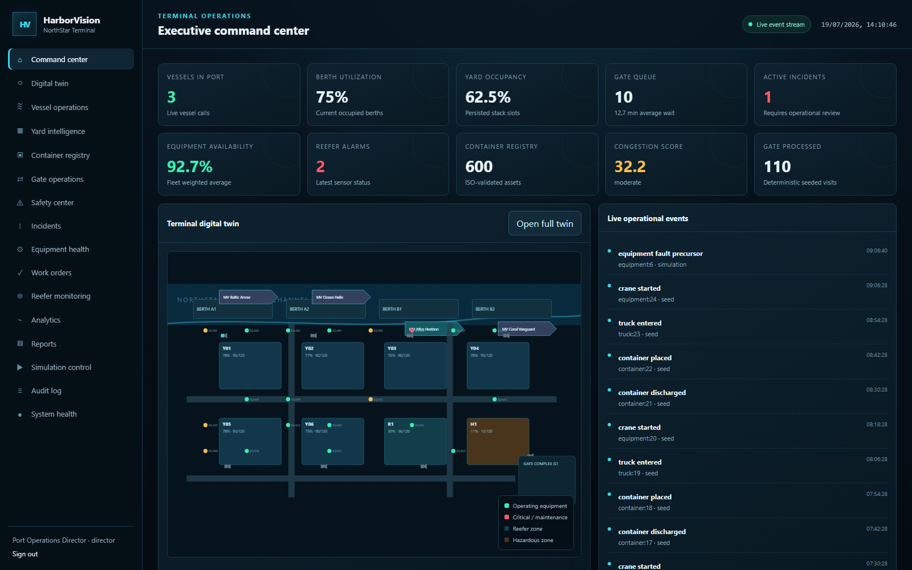
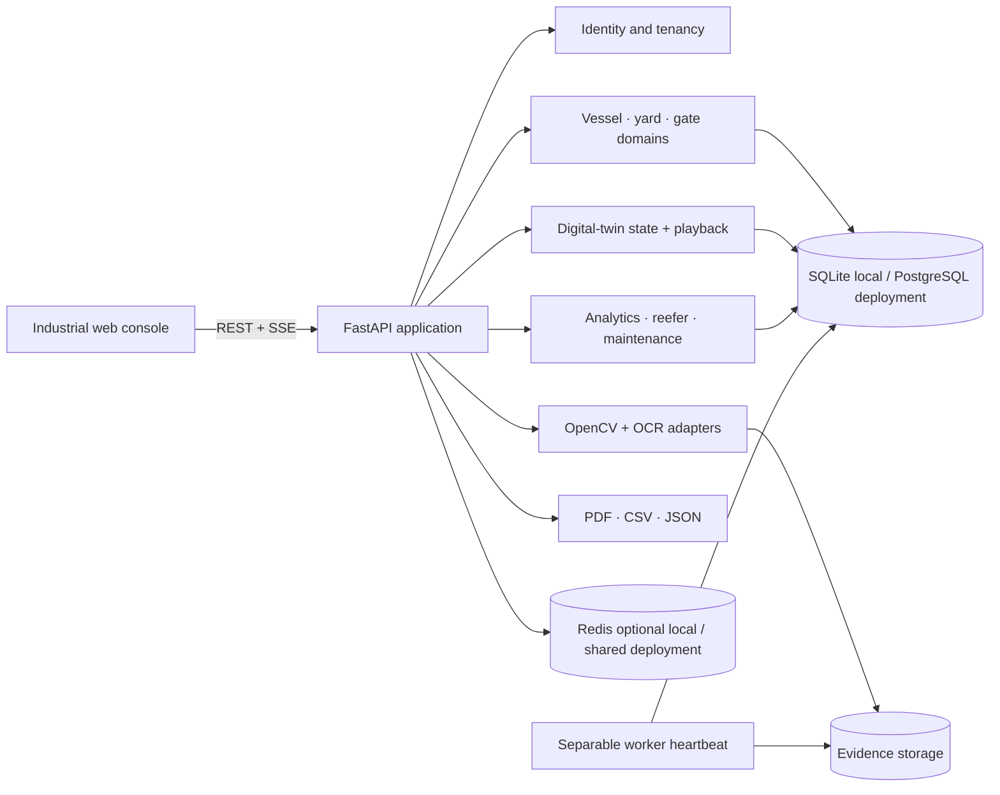

# HarborVision Twin

[](LICENSE)
[](https://github.com/HUSNAIN-MUNAWAR/harborvision-twin/actions/workflows/ci.yml)
[](pyproject.toml)
[](requirements.txt)
[](docs/vision-pipeline.md)

**An open-source, CPU-first digital twin and operational-intelligence platform for smart ports and container terminals.**

HarborVision Twin combines terminal state, vessel and berth planning, container lineage, explainable yard placement, gate operations, equipment and reefer monitoring, deterministic simulation, CPU computer vision, ISO 6346 OCR, incidents, maintenance work orders, analytics, reports, auditability, and historical playback in one runnable engineering demonstrator.

> HarborVision Twin is not a certified terminal operating system, safety controller, or failure-prediction product. It is a reproducible local platform for architecture, integration, computer-vision, and operational-intelligence evaluation.



## Why this project exists

Ports combine geospatial state, event ordering, physical constraints, time-series telemetry, video evidence, human review, and strict tenancy. Many portfolio projects reduce that problem to static dashboard cards. HarborVision Twin instead demonstrates connected operational workflows backed by persistence, deterministic data, real algorithms, enforceable transitions, and verification evidence.

## Phase 2 capabilities

### Operational digital twin

- Unified organization-scoped terminal state derived from persisted records.
- Vessels, berths, yard blocks, gate queues, equipment, cameras, incidents, work orders, and reefer alarms.
- Saved layer preferences and entity-focused operational views.
- Historical reconstruction from the nearest snapshot plus ordered events.
- Play, pause, speed, timeline slider, event inspection, and return-to-live controls.
- Duplicate protection and stale-event handling that preserves audit history without rolling live state backward.

### Port operations

- Vessel calls, planned/actual progress, turnaround calculations, and estimated completion.
- Berth validation for overlap, vessel length, draft, maintenance windows, and operational buffers.
- ISO 6346 container validation and append-only movement lineage.
- Explainable yard recommendation with ranked candidates and rejection reasons.
- Reefer, hazardous, reservation, weight, allocation, closure, capacity, tier, distance, and rehandle checks.
- Truck-visit stages and calculated queue, wait, service, turnaround, throughput, and appointment metrics.

### Intelligence and evidence

- Real OpenCV MP4 decoding, MOG2 foreground extraction, contours, confirmed centroid tracks, direction, polygon rules, dwell, cooldown, deduplication, annotated frames, and persisted evidence.
- CPU Tesseract OCR with stored original/crop/enhanced images, candidate ranking, ISO check digit, confidence, latency, and human review metadata.
- Equipment risk indicators comparing rolling z-score, EWMA, rate of change, and thresholds with supporting data-derived explanations.
- Reefer deviation duration, sensor/communication state, severity, trigger explanation, and suggested action.
- Ten report families in PDF, CSV, and JSON.
- Deterministic persisted scenario runs with create/start/pause/resume/reset/advance controls.

### Security and reliability

- PBKDF2-SHA256 password hashing.
- Expiring JWT access tokens and persisted rotating refresh tokens.
- Logout revocation and replay rejection.
- Failed-login and expensive-operation throttling.
- Role authorization and server-side organization isolation.
- Explicit CORS, CSP, frame, content-type, referrer, and permissions headers.
- Append-only audit events for important mutations and exports.
- Liveness and component readiness for database, Redis, storage, and worker heartbeat.
- Defensive Phase 1 → Phase 2 database migration.

## Architecture



The default deployment is a modular monolith because it is easier to run and verify on a laptop. Domain services, event projection, vision, reporting, simulation, persistence, and HTTP boundaries remain separate enough to extract later.

Read [the architecture guide](docs/architecture.md), [digital-twin design](docs/digital-twin.md), and [event model](docs/event-model.md).

## Technology stack

| Area | Implementation |
|---|---|
| API | Python 3.12+, FastAPI, Pydantic v2 |
| Persistence | SQLAlchemy 2, Alembic, SQLite local, PostgreSQL/PostGIS Docker target |
| Real time | Server-Sent Events with browser reconnect |
| Web console | Standards-based JavaScript, SVG, HTML, and custom CSS; no runtime build dependency |
| Vision | OpenCV, NumPy, Pillow |
| OCR | Tesseract through `pytesseract` |
| Analytics | SQL queries and deterministic Python domain algorithms |
| Reports | ReportLab, CSV, JSON |
| Infrastructure | Docker Compose, Redis, MinIO, Nginx, GitHub Actions |
| Testing | Pytest, FastAPI TestClient, Playwright capture workflow |

The web client is deliberately not presented as Next.js because the verified repository uses a zero-build console.

## Quick start

### Local SQLite mode

Requirements: Python 3.12+, Tesseract OCR, and OpenCV runtime libraries.

```bash
cd harborvision-twin
python -m venv .venv
source .venv/bin/activate          # Windows: .venv\Scripts\activate
python -m pip install -r requirements-dev.txt
cp .env.example .env

PYTHONPATH=apps/api alembic upgrade head
PYTHONPATH=apps/api python -m harborvision.seed
PYTHONPATH=apps/api uvicorn harborvision.main:app --reload --port 8000
```

Open:

- Operations console: `http://localhost:8000`
- OpenAPI: `http://localhost:8000/api/v1/docs`
- Readiness: `http://localhost:8000/api/v1/health/ready`

### Docker mode

```bash
cp .env.example .env
# Replace JWT_SECRET and local service passwords before sharing the environment.

docker compose config
docker compose up --build -d
docker compose exec api alembic upgrade head
docker compose exec api python -m harborvision.seed
docker compose ps
```

- Web console: `http://localhost:3000`
- API: `http://localhost:8000`
- MinIO console: `http://localhost:9001`

Docker configuration is included for contributors who want the PostgreSQL/PostGIS, Redis, MinIO, API, worker, and Nginx topology. If Docker is unavailable, use the local SQLite mode above; it exercises the same FastAPI domain services and browser console.

## Demo accounts

All fictional local accounts use the development-only password `HarborVision!2026`.

| Role | Email |
|---|---|
| Administrator | `admin@harborvision.local` |
| Operations director | `director@harborvision.local` |
| Berth planner | `planner@harborvision.local` |
| Yard controller | `yard@harborvision.local` |
| Safety officer | `safety@harborvision.local` |
| Analyst | `analyst@harborvision.local` |

Never reuse these credentials outside the local demonstration.

## Main workflows

### Search and move a container

1. Log in as yard controller or director.
2. Open **Container Registry** and inspect current location and movement history.
3. Request placement analysis to see ranked candidates, score components, rejected slots, and rehandle risk.
4. Move the container using a unique idempotency key.
5. The event engine updates both slots, current location, append-only movement history, and operational-event provenance in one transaction.

### Replay terminal history

1. Open **Digital Twin**.
2. Choose a persisted start and end time.
3. Load the window, inspect the nearest snapshot, and move through ordered events.
4. Use play, pause, speed, or the slider.
5. Return to live mode to reload relational current state.

### Process safety video

```bash
curl -X POST http://localhost:8000/api/v1/vision/process-sample \
  -H "Authorization: Bearer <development-access-token>"
```

The included legally generated MP4 is decoded frame by frame. Evidence is created only when a confirmed track satisfies the configured zone dwell rule.

### Evaluate OCR

```bash
PYTHONPATH=apps/api python scripts/ocr_evaluate.py
```

The result file clearly labels the data as synthetic and does not claim field accuracy.

## API examples

Login:

```bash
curl -X POST http://localhost:8000/api/v1/auth/login \
  -H 'Content-Type: application/json' \
  -d '{"email":"director@harborvision.local","password":"HarborVision!2026"}'
```

Container search:

```bash
curl 'http://localhost:8000/api/v1/containers?q=MSCU&limit=20' \
  -H 'Authorization: Bearer <token>'
```

Historical playback:

```bash
curl 'http://localhost:8000/api/v1/digital-twin/playback?start=2026-07-19T00:00:00Z&end=2026-07-19T08:00:00Z' \
  -H 'Authorization: Bearer <token>'
```

See [docs/api.md](docs/api.md) for contracts and failure behavior.

## Verification commands

```bash
make test
make lint
make format-check
make typecheck
make test-frontend
make migrate-check
make data-integrity
make verify
make security-scan
```

The launch verification includes backend tests, Ruff, MyPy, frontend syntax checks, compilation, fresh migrations, deterministic seeding, data-integrity checks, local API smoke tests, dependency checks, and repository hygiene scanning. OCR and screenshot regeneration require host-level Tesseract and Playwright/Chromium binaries; see the verification report for the exact commands run and any host-specific limitations.

## Project structure

```text
apps/
  api/harborvision/       FastAPI, domains, event state, vision, reports, simulation
  web/                    Industrial zero-build web console
  worker/                 Separable worker container
infrastructure/
  migrations/             Alembic migration history
  docker/                 Container definitions
scripts/                  Verification, integrity, OCR, media, hygiene, packaging
tests/                    Unit and integration coverage
data/sample/              Original generated MP4 and OCR samples
docs/                     Architecture, pipelines, audit, runbook, media, verification
.github/                   CI, issue forms, pull-request template
```

## Documentation

- [Phase 2 engineering audit](docs/phase2-audit.md)
- [Architecture](docs/architecture.md)
- [Domain model](docs/domain-model.md)
- [Digital twin](docs/digital-twin.md)
- [Event model](docs/event-model.md)
- [API guide](docs/api.md)
- [Vision pipeline](docs/vision-pipeline.md)
- [OCR pipeline](docs/ocr-pipeline.md)
- [KPI definitions](docs/kpi-definitions.md)
- [Deployment](docs/deployment.md)
- [Demo data](docs/demo-data.md)
- [Runbook](docs/runbook.md)
- [Security](docs/security.md)
- [Verification report](docs/verification-report.md)

## Screenshots and walkthrough

Real application media is stored under [`docs/screenshots`](docs/screenshots/) and [`docs/demo`](docs/demo/). Capture scripts use the implemented web code and API responses. They do not add unimplemented UI elements in post-processing.

- [Command center](docs/screenshots/command-center.png)
- [Historical playback](docs/screenshots/historical-playback.png)
- [Container movement history](docs/screenshots/container-movement-history.png)
- [Safety evidence screenshot](docs/screenshots/safety-event-evidence.png)
- [Verified intrusion evidence image](docs/evidence/restricted-zone-intrusion.jpg)
- [Generated daily terminal PDF](docs/reports/daily-terminal-operations.pdf)
- [Simulation lifecycle](docs/screenshots/simulation-control.png)
- [Phase 2 MP4 walkthrough](docs/demo/harborvision-phase2-walkthrough.mp4)

## Security

Read [SECURITY.md](SECURITY.md) before reporting a vulnerability. Do not open a public issue containing credentials, real port data, private camera imagery, tokens, or exploit details.

The repository hygiene gate checks for environment files, common token formats, private keys, and personal absolute paths. This is a release aid, not a substitute for a dedicated secret scanner.

## Known limitations

- Synthetic NorthStar data is used throughout the default demo.
- The verified browser client is not Next.js.
- Docker/PostGIS/Redis/MinIO runtime validation depends on a Docker-capable host.
- The local worker is a heartbeat/process-separation baseline, not a production distributed queue or dead-letter service.
- The video baseline does not claim semantic person, vehicle, PPE, or certified safety accuracy.
- OCR results on generated images do not establish outdoor gate-camera performance.
- Predictive-maintenance outputs are risk indicators, not guarantees of mechanical failure.
- Real deployment requires TOS, PLC/SCADA, RTSP, GIS, identity, privacy, security, HA, backup, disaster-recovery, and operational-acceptance integrations.

## Contributing and license

Contributions are welcome when they preserve tenancy, auditability, deterministic validation, licensing, and honest verification. Read [CONTRIBUTING.md](CONTRIBUTING.md) and [CODE_OF_CONDUCT.md](CODE_OF_CONDUCT.md).

Licensed under the [MIT License](LICENSE). All default terminal geometry, records, images, and video are original generated assets. No model weights or proprietary port maps are redistributed.
