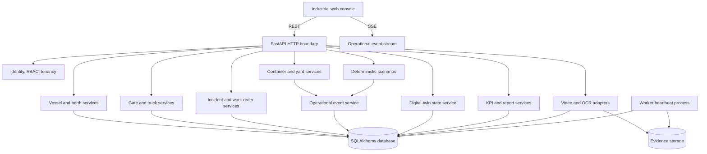
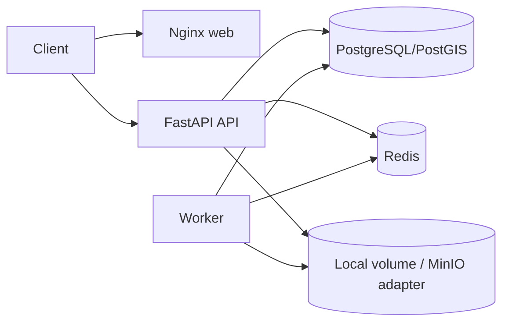

# Architecture

## Decision record

### Modular monolith

The local release uses one FastAPI deployment because it minimizes setup and makes critical workflows transactional. Modules separate identity, port operations, events, digital-twin projection, analytics, reports, simulation, OCR, and vision. The worker image demonstrates process separation and heartbeat observability without pretending a distributed queue is already present.

### Relational current state plus operational events

Relational tables support efficient command-center queries and integrity constraints. Operational events preserve provenance, idempotency, correlation, causation, historical ordering, and replay. Events do not bypass domain validation.

### Local-first adapters

- SQLite and local filesystem are fully runnable defaults.
- PostgreSQL/PostGIS, Redis, and MinIO are Compose deployment targets.
- The browser console has no runtime package-install step.
- Computer vision and OCR use CPU-compatible local libraries.

## Component architecture

## Domain boundaries

- **Identity and access:** users, password hashes, access tokens, refresh tokens, roles, tenant context, login audits.
- **Terminal configuration:** organization, terminal geometry, berths, blocks, slots, lanes, cameras, zones.
- **Vessel and berth operations:** vessel calls, progress, compatibility, conflicts, turnaround.
- **Container and yard operations:** ISO identity, current location, movement history, placement validation, recommendations, rehandle risk.
- **Gate and truck operations:** appointment and stage timestamps, queue/service/turnaround metrics.
- **Operational events:** canonical provenance, idempotency, stale-event protection, correlation and causation.
- **Digital twin:** current state assembly, snapshots, replay projection.
- **Vision and OCR:** local adapters, track/rule state, evidence, review jobs.
- **Equipment and reefers:** deterministic time series, risk methods, deviation rules.
- **Incidents and work orders:** enforced transition policies, attribution, due state, audit.
- **Analytics and reports:** source-record calculations and exports.
- **Simulation:** deterministic scenario runs using production services.

## Request flow

1. Middleware assigns or preserves `X-Request-ID` and measures duration.
2. Authentication resolves the active user.
3. Authorization enforces role and organization scope.
4. Pydantic validates the request shape.
5. A domain service validates business constraints.
6. SQLAlchemy performs the transaction.
7. Mutation routes append audit and operational provenance.
8. The API returns a consistent status and safe error detail.

## Security boundaries

The browser is untrusted. Organization filtering, permissions, slot ownership, incident ownership, work-order ownership, and report scope are enforced in backend queries. Evidence paths are repository-relative. Tokens and secrets are never logged intentionally.

## Deployment topology

## Scale evolution

At larger scale, extract video ingestion, report generation, simulations, and projection building into idempotent jobs; add a real queue, dead-letter visibility, partitioned events, snapshot compaction, geospatial columns/indexes, object-storage signed URLs, and observability backends. The repository does not claim those production properties today.
