# Vision and OCR Pipeline

## Sample media

The seed creates:

- `data/sample/restricted-zone-demo.mp4`
- `data/sample/container-code-sample.png`

Both are original synthetic assets generated by repository code.

## Video pipeline

```mermaid
flowchart LR
  MP4[MP4 Frame] --> Time[Frame Timestamp]
  Time --> MOG2[MOG2 Background Subtraction]
  MOG2 --> Clean[Median Blur + Morphology]
  Clean --> Contours[Area-filtered Contours]
  Contours --> Boxes[Bounding Boxes and Centroids]
  Boxes --> Tracker[Nearest-centroid Tracker]
  Tracker --> Polygon[Polygon Membership]
  Polygon --> Rule[Dwell + Cooldown Rule]
  Rule --> Event[Persisted Safety Event]
  Event --> Evidence[Annotated JPEG]
```

### Tracker behavior

Tracks retain ID when the nearest new centroid is within a configured maximum distance. Missed tracks age and are deleted after a threshold. Each track stores first/last seen, bounding box, centroid, per-zone entry time, and last emitted time.

### Rule behavior

A restricted-zone event is emitted only when the tracked centroid remains inside the polygon longer than the configured dwell threshold and the per-track, per-zone cooldown has elapsed. This suppresses duplicate alerts.

### Verified scope

The pipeline classifies **motion-derived tracked objects**, not people or vehicles. Semantic detection and PPE claims require model weights, representative validation data, deployment-specific camera calibration, and safety review.

## OCR pipeline

```mermaid
flowchart LR
  Image --> ROI[Configurable Code ROI]
  ROI --> Gray[Grayscale]
  Gray --> CLAHE[CLAHE]
  CLAHE --> Blur[Gaussian Blur]
  Blur --> Otsu[Otsu Threshold]
  Otsu --> Tesseract[Tesseract Whitelist]
  Tesseract --> Normalize[Text Normalization]
  Normalize --> Pattern[ISO Pattern Candidates]
  Pattern --> Check[ISO 6346 Check Digit]
  Check --> Review[Valid or Review Required]
```

The returned object includes raw text, normalized candidate, confidence, validation status, alternative candidates, processing time, and pipeline stages.

## Performance

The verification report records actual processing time and FPS from the delivery host. Results are specific to that hardware and synthetic sample and must not be generalized as field accuracy.
